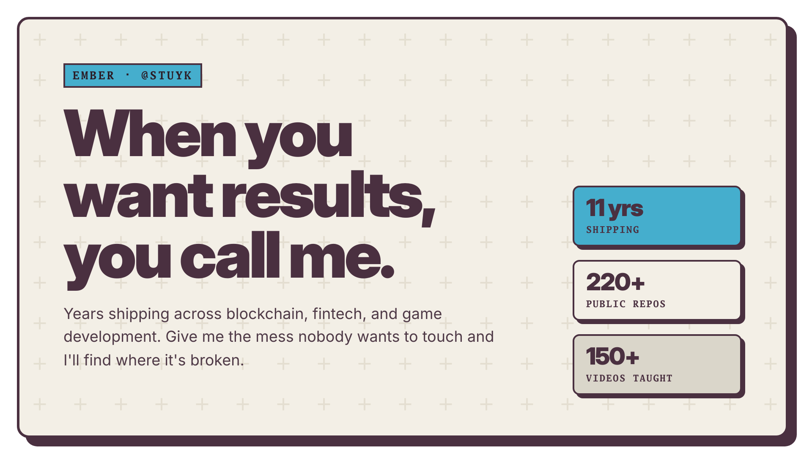
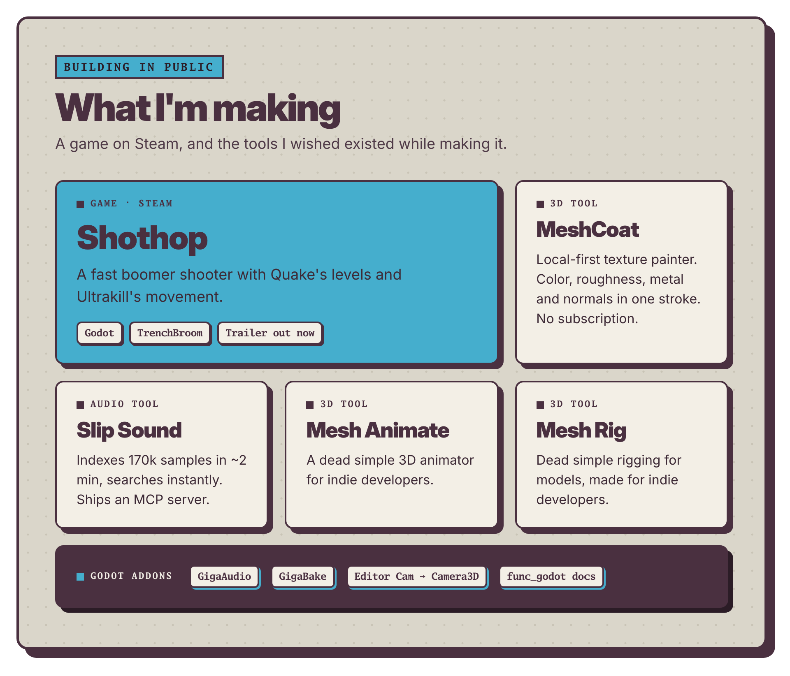
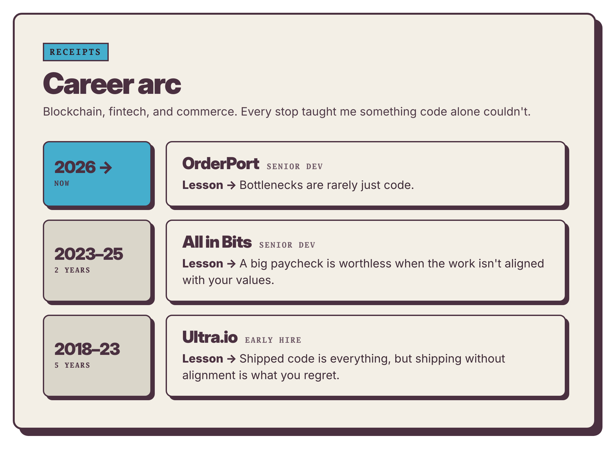
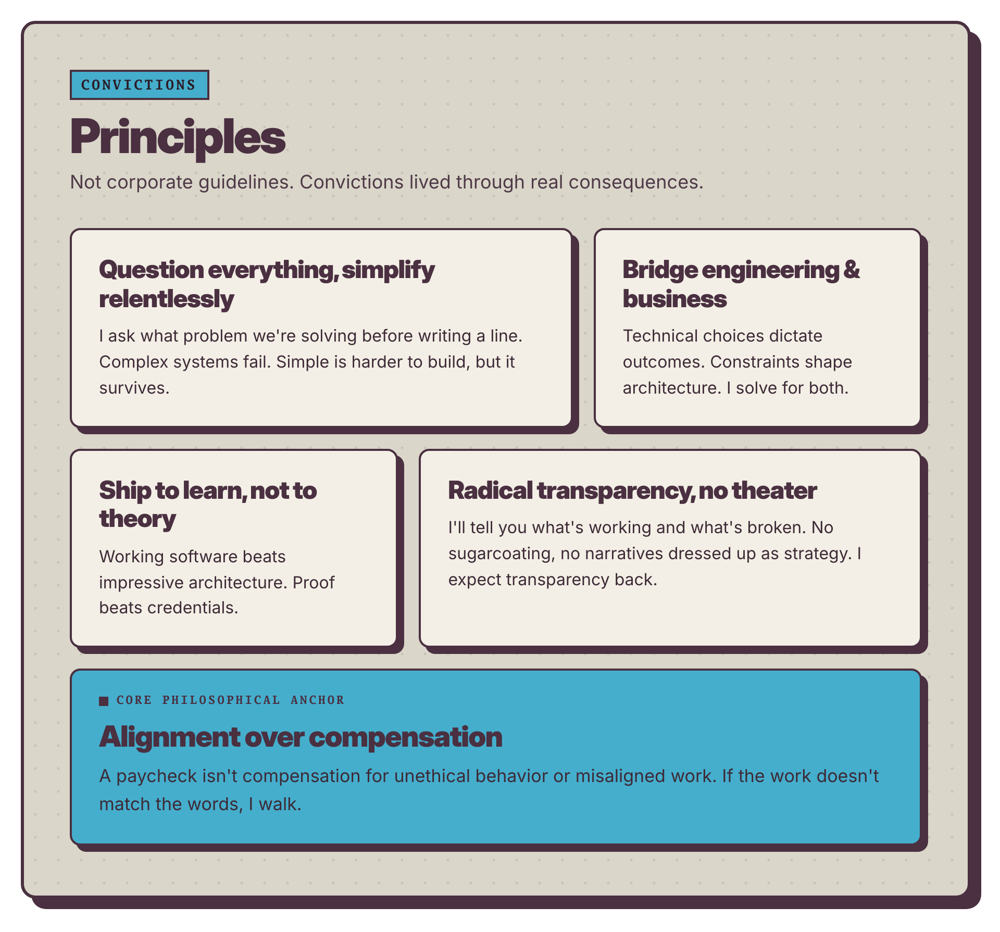
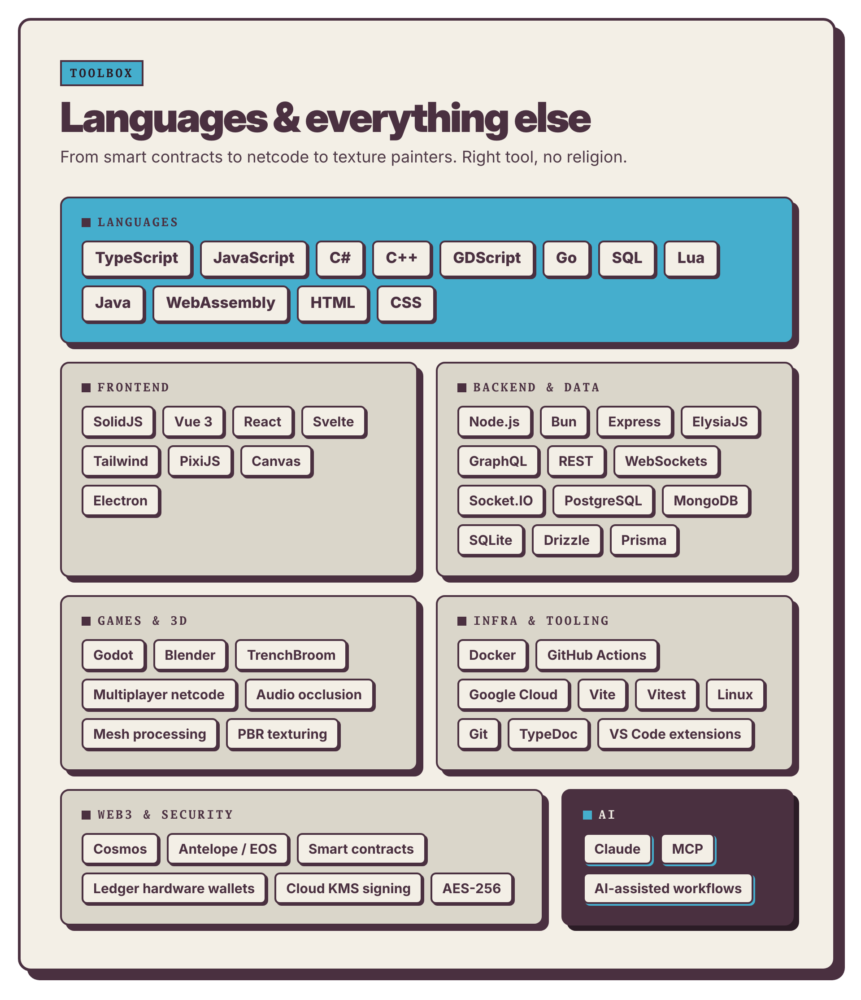

<!-- hypedoc:start -->
<!-- Generated by HypeDoc. Edit the .html sources and run `hypedoc build`; changes inside this block are overwritten. -->

  

  

  

  

  

<!-- hypedoc:end -->

 

<b>⋆˙⟡ &nbsp;Read the full story: who I am, what I ship, and everything I work with</b>

 

Systems engineer, indie game dev, and teacher. 11 years of shipping, 220+ public repos, 150+ videos.

---

### ⋆˙⟡  &nbsp;From the ashes

I spent a long time behind a mask, answering to a name that never fit.
I finally opened the door. The name I found on the other side is Ember.

Everything here is built the same way: find the one ember left, fan it gently, and rebuild the fire.

I am Ember.

<i>The fog is less dense today. Tomorrow it will be even better.</i>

---

### ⋆˙⟡ &nbsp;What I'm making

**[Shothop](https://store.steampowered.com/app/4298650/Shothop/)** - a fast boomer shooter with Quake's levels and Ultrakill's movement. Built in Godot. [Watch the trailer ↗](https://www.youtube.com/watch?v=NgzW91K71Ts)

**[MeshCoat](https://github.com/Stuyk/meshcoat)** - a local-first 3D texture painter. Open a model and paint color, roughness, metal and normals in one stroke. No subscription.

**[Slip Sound](https://github.com/Stuyk/slip-sound)** - a fast audio sample finder. Indexes 170k files in about two minutes and searches them instantly. Includes an MCP server.

**[Mesh Animate](https://github.com/Stuyk/meshanimate)** - a dead simple 3d animator for indie developers

**[Mesh Rig](https://github.com/Stuyk/meshrig)** - a dead simple 3d rigging software for models, made for indie developers

---

### ⋆˙⟡  &nbsp;Godot Addons

- **[GigaAudio](https://github.com/Stuyk/GigaAudio-Godot)**: lightweight audio occlusion for Godot 4.3+
- **[GigaBake](https://github.com/Stuyk/gigabake-godot)**: bake a mesh, collision and occluders in one click
- **[Editor Cam → Camera3D](https://github.com/Stuyk/godot-create-cam-from-editor-cam)**: make a camera from the editor view with one button
- **[func_godot docs](https://github.com/Stuyk/func_godot_modern_docs)**: better docs for FuncGodot

---

### ⋆˙⟡  &nbsp;Career arc

| When | Where | Lesson |
| --- | --- | --- |
| 2026 to now | **OrderPort** · Senior Dev | Bottlenecks are rarely just code. |
| 2023 to 2025 | **All in Bits** · Senior Dev | A big paycheck is worthless when the work isn't aligned with your values. |
| 2018 to 2023 | **Ultra.io** · Early hire | Shipped code is everything, but shipping without alignment is what you regret. |

---

### ⋆˙⟡  &nbsp;Skills

**Languages** 
           

**Frontend** 
       

**Backend & Data** 
            

**Games & 3D** 
      

**Infra & Tooling** 
        

**Web3 & Security** 
     

**AI** 
  

---

### ✧₊⁺ &nbsp;What I believe

- Simple systems survive. Complex ones fail.
- Ship to learn. Proof beats credentials.
- Say what's working and what's broken.
- Be seen as who you are.
- Radical transparency

---

·☽ ◯ ☾·

🏳️‍🌈&nbsp; <i>Be kind to yourselves.</i> &nbsp;🏳️‍⚧️

